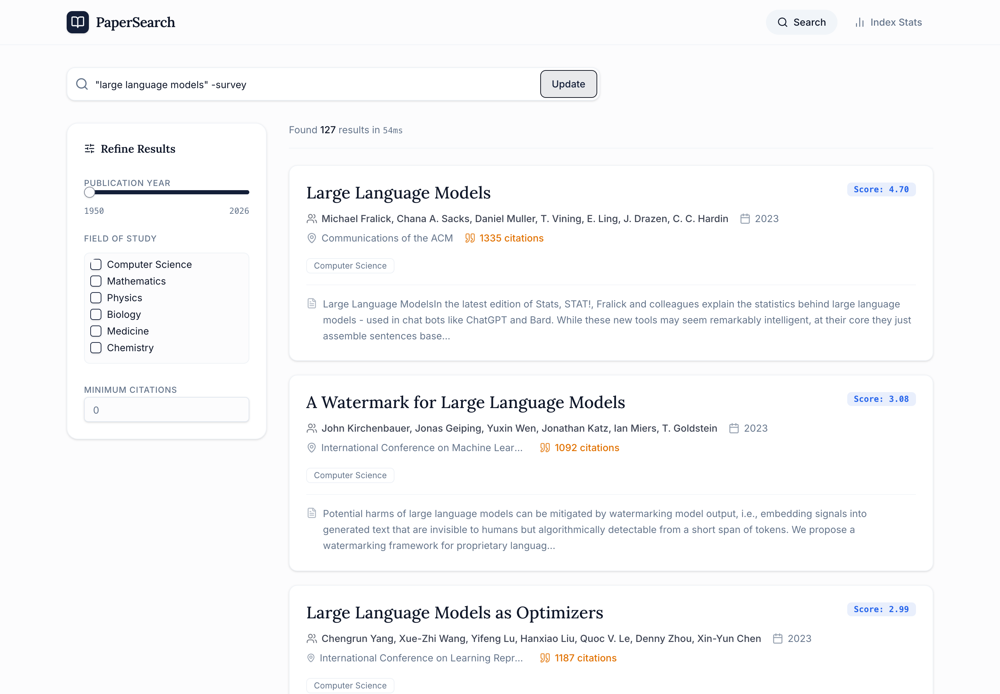
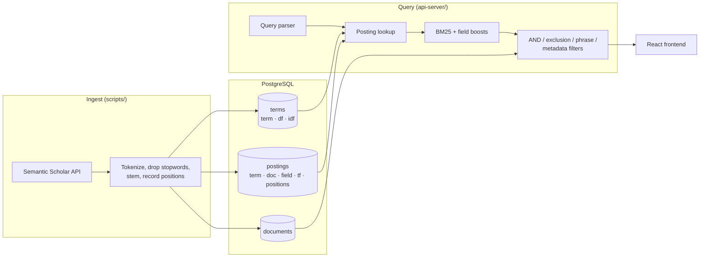

# PaperSearch

A search engine for academic papers, built from scratch in TypeScript: no Elasticsearch, Solr, or Lucene. The inverted index, BM25 ranking, query parser, phrase matching, typo correction, and "similar papers" are all hand-written on top of PostgreSQL.



**1,166 papers · 12,024 indexed terms · 101,329 postings · ~7 ms median query time**

## Features

- **BM25 ranking** with per-field boosts (title > abstract > authors)
- **Query syntax**: phrases, `AND`, `-exclusion` / `NOT`, and field scoping (`title:transformer`)
- **Phrase search** verified against stored token positions
- **Typo correction**: "Did you mean" rewrites the whole query using Levenshtein distance against the index vocabulary
- **Similar papers** from each paper's top TF-IDF terms
- **Autocomplete** from the title vocabulary
- **Filters** for publication year, field of study, and minimum citations
- **Ingestion pipeline** that pulls papers from the Semantic Scholar API and indexes them in one command

| Typo correction | Paper page with similar papers |
|---|---|
|  |  |

## How it works



### Indexing

Each paper's title, abstract, and author names are tokenized, lowercased, stripped of stopwords, and Porter-stemmed. Every stemmed term gets one row in `terms` (with document frequency and precomputed IDF) and one row in `postings` per (term, document, field), storing the normalized term frequency and the token positions. Positions are what make phrase queries possible. IDF is recomputed across the whole vocabulary after every batch, so scores stay correct as the corpus grows.

### Ranking

Candidates are scored with BM25 per field, then summed with field boosts:

```
score(t, d) = IDF(t) · tf·(k1 + 1) / (tf + k1·(1 − b + b·|d|/avgdl))
IDF(t)      = ln((N − df + 0.5) / (df + 0.5) + 1)

k1 = 1.5, b = 0.75, boosts: title 2.0 · abstract 1.0 · authors 0.5
```

Average field lengths (`avgdl`) are kept in `index_stats` and updated by the indexer.

### Query syntax

| Query | Meaning |
|---|---|
| `neural networks` | Any of the terms (OR), ranked by BM25 |
| `"neural networks"` | Exact phrase, checked against token positions (stopword gaps allowed) |
| `deep AND learning` | Every term must appear |
| `learning -deep` / `learning NOT deep` | Exclude papers containing `deep` |
| `title:transformer` | Match in a specific field (`title`, `abstract`, `author`) |

### Typo correction

If a query word matches no postings, it is compared against the vocabulary using Levenshtein edit distance (max 2). Each missing word is replaced with its closest term, and the corrected query is offered as "Did you mean". For example, `speach recogniton` becomes `speech recognition`.

### Similar papers

The paper's ten highest TF-IDF terms from its title and abstract (skipping terms that appear in no other paper) are run as a ranked OR query against the rest of the index.

## Tech stack

- **Backend:** TypeScript, Node.js, Express 5, PostgreSQL, Drizzle ORM, Redis (optional, for rate limiting)
- **Frontend:** React, Vite, TanStack Query, Tailwind CSS, Radix UI
- **API contract:** OpenAPI spec, with typed React Query hooks and Zod validators generated by Orval
- **Text processing:** the [`natural`](https://github.com/NaturalNode/natural) package for the tokenizer, Porter stemmer, and stopword list. Everything after tokenization is hand-written.
- **Data:** [Semantic Scholar Graph API](https://api.semanticscholar.org/)
- **Monorepo:** pnpm workspaces

## Running locally

Requirements: Node.js 22.9+, pnpm, PostgreSQL. Redis is optional; without it, rate limiting runs in memory.

```bash
pnpm install

cp .env.example .env
# Set DATABASE_URL. A free SEMANTIC_SCHOLAR_API_KEY is recommended
# (anonymous requests are heavily rate-limited).

pnpm --filter @workspace/db push               # create tables
pnpm --filter @workspace/scripts pipeline      # fetch + index ~1,000 papers (about 10 min)
                                               # or: pipeline --limit 20 for a quick run

pnpm --filter @workspace/api-server dev        # API on http://localhost:3000
pnpm --filter @workspace/frontend dev          # UI on http://localhost:5173
```

Interactive API docs are at http://localhost:3000/api/docs.

## API

| Endpoint | Description |
|---|---|
| `GET /api/search?q=` | Ranked search. Optional `page`, `pageSize`, `yearFrom`, `yearTo`, `fieldOfStudy`, `minCitations` |
| `GET /api/search/suggest?q=` | Autocomplete suggestions |
| `GET /api/papers/:paperId` | Paper details |
| `GET /api/papers/:paperId/similar` | Similar papers |
| `GET /api/stats` | Index statistics |
| `GET /api/health` | Database and Redis health |

## Tests

```bash
pnpm --filter @workspace/api-server test
```

20 unit tests (Node's built-in test runner) cover the query parser, BM25 and IDF math, and Levenshtein distance.

## Project structure

```
artifacts/
  api-server/   Express API: query parser, BM25 search, routes
  frontend/     React UI
lib/
  db/           Drizzle schema + BM25 functions
  api-spec/     OpenAPI spec (source of truth) + Orval codegen config
  api-zod/      Generated Zod schemas
  api-client-react/  Generated React Query hooks
scripts/        Ingestion pipeline (fetch → preprocess → index) and index repair tool
```

## Limitations and next steps

- **Boolean logic is flat.** `AND` makes every term required, and parentheses are ignored rather than grouped. A recursive-descent parser producing an AST would support nested expressions.
- **Typo correction scans the vocabulary linearly** (~50 ms). A BK-tree or a trigram index would make it sub-millisecond.
- **Scoring happens in Node over all candidate postings.** That's fast at this scale, but millions of documents would need top-k pruning (WAND / MaxScore) and sharded postings.
